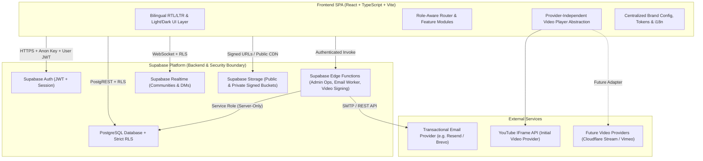

# ATHAR ACADEMY — System Architecture

**Phase:** 00 — Foundation Architecture Blueprint  
**Target Stack:** React, TypeScript, Vite, Supabase (Auth, PostgreSQL, RLS, Storage, Realtime, Edge Functions), YouTube IFrame Player API

---

## 1. Overall System Architecture

ATHAR ACADEMY is architected as a **clean, modular Single-Page Application (SPA)** backed by **Supabase** as a unified, low-cost Backend-as-a-Service (BaaS) platform. All security boundaries, authorization checks, enrollment gates, and privileged operations are enforced on the backend via **PostgreSQL Row Level Security (RLS)**, **SQL SECURITY DEFINER RPCs**, and **Supabase Edge Functions**—never solely in frontend code.



---

## 2. User Roles & Permission Model

Role enforcement uses a dedicated `profiles.role` enum (`super_admin`, `instructor`, `student`) stored in PostgreSQL, protected from client-side self-escalation via RLS and column-level triggers.

| Capability | Visitor | Student | Instructor | Super Admin |
|---|:---:|:---:|:---:|:---:|
| Browse published courses, descriptions, instructor bios, published reviews | Yes | Yes | Yes | Yes |
| Register / Login / Password recovery | Yes | Yes | Yes | Yes |
| Request course enrollment | No | Yes | No* | Yes |
| View lessons & download course resources | No | Approved courses only | Assigned courses only | All |
| Track playback & lesson completion | No | Approved courses only | View analytics (assigned) | View all |
| Create/edit/reorder lessons & upload resources | No | No | Assigned courses only | All |
| Participate in course community | No | Approved courses only | Assigned courses (with moderation) | All (with moderation) |
| Direct messaging | No | With instructors of approved courses | With students of assigned courses | Moderation / audit access |
| Send course announcements & emails | No | No | Assigned courses only | Platform-wide or per-course |
| Approve/reject enrollments & assign instructors | No | No | No | Yes |
| Manage roles, platform settings, all users | No | No | No | Yes |

*\*Note: If an instructor also wishes to enroll as a student in another course later, enrollment records remain user-scoped (`user_id`), allowing future dual participation without changing the security model.*

### Trusted Role Assignment Mechanism
- New signups via Supabase Auth **always** receive the `student` role via a PostgreSQL `handle_new_user()` trigger on `auth.users`.
- Client-supplied metadata (e.g., `role: 'super_admin'` in `signUp()`) is **strictly ignored**.
- Only a `super_admin` invoking a verified Edge Function (or a secure database seed/migration for the initial platform owner) can promote or demote users to `instructor` or `super_admin`.
- A `BEFORE UPDATE` trigger on `profiles` rejects any `role` change unless executed by a trusted service/admin context.

---

## 3. Main System Modules

1. **Identity, Profiles & Preferences Module**
   - Auth flows (sign up, sign in, sign out, password reset, email verification).
   - User profiles with bilingual display names/bios, avatar URL, preferred `locale` (`ar` | `en`), and `theme` (`light` | `dark` | `system`).
2. **Course Catalog & Content Module**
   - Bilingual categories (`title_ar`, `title_en`, `slug`).
   - Bilingual courses (`title_ar`, `title_en`, `description_ar`, `description_en`, thumbnail, status: `draft` | `published` | `archived`, sequential lock toggle).
   - Many-to-many `course_instructors` join table supporting multiple instructors per course.
   - Ordered `lessons` (`sort_order`, bilingual titles/summaries, provider-independent video fields, `is_preview` flag for optional free previews).
   - `lesson_resources` (downloadable PDFs, slides, code archives stored in private Supabase Storage).
3. **Enrollment & Approval Workflow Module**
   - `enrollments` table with states: `pending`, `approved`, `rejected`, `revoked` (and `is_active` boolean / timestamps).
   - Unique constraint on `(course_id, student_id)` preventing duplicate active requests.
   - Super Admin review queue with optional approval/rejection notes and audit trail (`reviewed_by`, `reviewed_at`).
4. **Provider-Independent Video & Learning Progress Module**
   - Database stores `video_provider` (`youtube_unlisted`, `cloudflare_stream`, `vimeo`, `custom_hls`), `video_source_id`, `duration_seconds`, and `video_metadata` (JSONB).
   - `lesson_progress` tracks `last_position_seconds`, `watched_seconds`, `completion_percent`, `is_completed`, `completed_at`.
   - Sequential unlocking evaluated on both backend (RPC/RLS helper checking whether the previous lesson by `sort_order` is completed when `course.require_sequential_lessons = true`) and frontend UI.
   - Course progress aggregated dynamically via SQL view/RPC.
5. **Course Communities & Moderation Module**
   - One private community channel per course (`course_communities` / `community_messages`).
   - Message types: `discussion`, `announcement` (instructors/admins only).
   - Threaded replies (`parent_message_id`), pinned messages (`is_pinned`, instructor/admin only), soft deletion & moderation logs, and private Storage attachments (`community_attachments`).
   - Realtime updates via Supabase Realtime Postgres Changes scoped to authorized course channels.
6. **Direct Messaging Module**
   - `dm_conversations` anchored to `(course_id, student_id, instructor_id)` to guarantee conversations can only exist when an approved enrollment and active course-instructor assignment exist.
   - `dm_messages` with read receipts (`read_at`), optional attachments, and Realtime subscription.
7. **Asynchronous Email & Notification Engine**
   - `notifications` table for in-app notification bell & unread counts.
   - `email_queue` table (`id`, `recipient_email`, `recipient_user_id`, `template_key`, `locale`, `payload_json`, `status`: `queued` | `processing` | `sent` | `failed`, `attempts`, `max_attempts`, `next_retry_at`, `last_error`, `created_by`).
   - `email_delivery_logs` table for immutable audit and provider message IDs.
   - Database triggers and authorized Edge Functions enqueue emails; a scheduled Edge Function (`process-email-queue`, triggered via `pg_cron` or webhook) processes batches with exponential backoff.
   - Frontend components **never** call external email APIs directly.
8. **Reviews, Ratings & Analytics Module**
   - `course_reviews` (one per approved student per course, moderation status `published` | `hidden`).
   - Materialized or on-demand SQL views/RPCs for course completion rates, active learners, enrollment funnel, and instructor course metrics.

---

## 4. Backend Responsibilities (Supabase)

| Layer | Responsibilities |
|---|---|
| **PostgreSQL Schema** | Normalized relational tables with foreign keys, composite indexes (especially on `course_id`, `student_id`, `instructor_id`, `status`, `created_at`), bilingual text columns, and check constraints. |
| **Row Level Security (RLS)** | Enabled on **every** table in `public`. Uses small, indexed `SECURITY DEFINER` helper functions (`is_super_admin()`, `is_course_instructor(course_id)`, `is_enrolled_student(course_id)`) to avoid recursive RLS lookups and ensure consistent, fast policy evaluation. |
| **Storage Buckets** | `public-assets` (course thumbnails, instructor avatars — public read, admin/instructor scoped write); `lesson-resources` (private — signed URLs issued only to approved students, assigned instructors, and admins); `community-attachments` (private — signed URLs scoped to course participants). |
| **Edge Functions** | `admin-manage-user-role`, `enqueue-course-announcement`, `process-email-queue`, `issue-signed-asset-url`, and future `issue-video-playback-token` (for Cloudflare Stream / Vimeo). |
| **Realtime** | Broadcasts new `community_messages`, `dm_messages`, and `notifications` filtered by RLS so unauthorized users cannot subscribe to private course or DM data. |

---

## 5. Frontend Responsibilities (React + TypeScript + Vite)

```text
src/
├── app/                    # App shell, providers (Auth, Theme, I18n, Query), router
├── config/                 # Centralized brand.ts, env.ts (validated), routes.ts
├── styles/                 # tokens.css (light/dark), typography.css, global.css
├── i18n/                   # Translation dictionaries (en/, ar/) & direction manager
├── lib/                    # supabaseClient.ts (anon key only), api helpers, formatters
├── components/
│   ├── ui/                 # Reusable accessible primitives (Button, Card, Input, Modal, etc.)
│   ├── brand/              # <BrandLogo /> (auto light/dark/stacked/icon), <LanguageSwitcher />, <ThemeSwitcher />
│   └── video/              # <VideoPlayer /> + adapters (YouTubeUnlistedAdapter, future adapters)
└── features/
    ├── public/             # Landing, catalog, course details, instructor profile
    ├── auth/               # Login, register, forgot/reset password
    ├── student/            # Student dashboard, classroom/lesson player, progress, reviews
    ├── instructor/         # Instructor dashboard, lesson builder, student analytics, announcements
    ├── admin/              # Super Admin dashboard, approvals, users, courses, email logs
    ├── community/          # Per-course community feed, threads, pins, moderation
    └── messaging/          # Student ↔ Instructor direct messages
```

### Key Frontend Architectural Rules
- **Data Fetching & Caching:** Use `@tanstack/react-query` for server state, optimistic UI where safe, and cache invalidation.
- **Logical CSS Only:** All spacing, borders, and positioning use logical properties (`margin-inline`, `padding-inline`, `inset-inline`, `text-align: start`) so Arabic RTL and English LTR share one clean layout system.
- **Zero-FOUC Theme Initialization:** A tiny synchronous inline script in `index.html` reads saved theme (`light` | `dark` | `system`) and sets `data-theme` before React hydrates.
- **Video Player Abstraction:**
  ```ts
  export interface VideoSource {
    provider: 'youtube_unlisted' | 'cloudflare_stream' | 'vimeo' | 'custom_hls';
    sourceId: string;
    signedUrl?: string;
    startSeconds?: number;
  }
  ```
  The `<VideoPlayer>` component delegates playback to a provider-specific adapter and emits normalized events (`onProgress`, `onComplete`, `onError`), decoupling course pages from YouTube.

---

## 6. External Service Integrations

| Service | Purpose | Cost Tier | Swappability |
|---|---|---|---|
| **Supabase** | Auth, Postgres, RLS, Storage, Realtime, Edge Functions | Free tier → Pro ($25/mo) as scale grows | Standard PostgreSQL + SQL migrations |
| **YouTube IFrame Player API** | Initial video playback (Unlisted videos) | Free | Isolated behind `VideoPlayerAdapter` |
| **Future: Cloudflare Stream / Vimeo** | Signed/tokenized video hosting with stronger access control | Pay-as-you-go when revenue justifies | Drop-in adapter + Edge Function token signer |
| **Transactional Email (Resend / Brevo)** | Reliable delivery for auth, approvals, announcements | Free tier (e.g., 3,000 emails/mo) | Isolated inside `process-email-queue` Edge Function |
| **Hosting (Vercel / Cloudflare Pages)** | Static SPA hosting with global CDN & preview deploys | Free tier | Standard Vite static build (`dist/`) |

---

## 7. Security Boundaries

1. **No Service-Role Key in Frontend:** Frontend uses only `VITE_SUPABASE_URL` and `VITE_SUPABASE_ANON_KEY` (publishable key). `SUPABASE_SERVICE_ROLE_KEY` and email API keys exist strictly in Supabase Edge Function secrets.
2. **Backend-Enforced Enrollment Gate:** Querying `lessons` or requesting a `lesson_resources` signed URL fails at the PostgreSQL/RLS layer unless `is_enrolled_student(course_id)` (checking `status = 'approved' AND is_active = true`), `is_course_instructor(course_id)`, or `is_super_admin()` returns `true`.
3. **Strict Instructor Isolation:** Instructors can only `SELECT`/`INSERT`/`UPDATE`/`DELETE` lessons, resources, announcements, and student progress for `course_id` values present in `course_instructors` for their `auth.uid()`.
4. **Private Communities & DMs:** Every `community_messages` and `dm_messages` query and Realtime subscription is gated by RLS verifying course membership or conversation participation.
5. **Email Abuse Prevention:** Bulk announcement endpoints validate caller role and course assignment server-side, enforce rate limits, and write to `email_queue` rather than allowing arbitrary recipient lists from the client.
6. **Honest Video Security Posture:** YouTube Unlisted does **not** prevent link sharing. The architecture explicitly separates lesson authorization from video playback and reserves a `issue-video-playback-token` Edge Function boundary so future paid/sensitive courses can move to Cloudflare Stream or Vimeo signed URLs without changing the LMS core.

---

## 8. Future Scalability Considerations

- **Database Indexing & Pagination:** Cursor-based pagination for course catalogs, community feeds, direct messages, and email logs; composite indexes on all RLS filter columns (`(course_id, student_id, status)`, `(course_id, instructor_id)`).
- **Multi-Instructor & Multi-Discipline Growth:** Categories support hierarchical or multi-tag extension; `course_instructors` already supports co-instructors and teaching assistants via an optional `assignment_role` column.
- **Email Queue Throughput:** Batch processing with `FOR UPDATE SKIP LOCKED` in PostgreSQL allows safe concurrent worker execution if email volume grows to thousands per hour.
- **Media & Bandwidth:** Course thumbnails and avatars served via Supabase CDN / image transformations; downloadable attachments gated via short-lived signed URLs.
- **Observability:** Structured logging in Edge Functions, immutable `email_delivery_logs`, and an `audit_logs` table recording role changes, enrollment approvals, and moderation actions.
